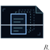
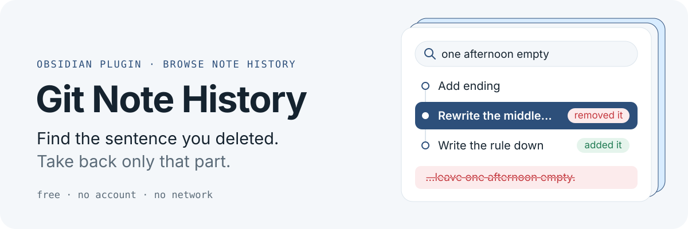
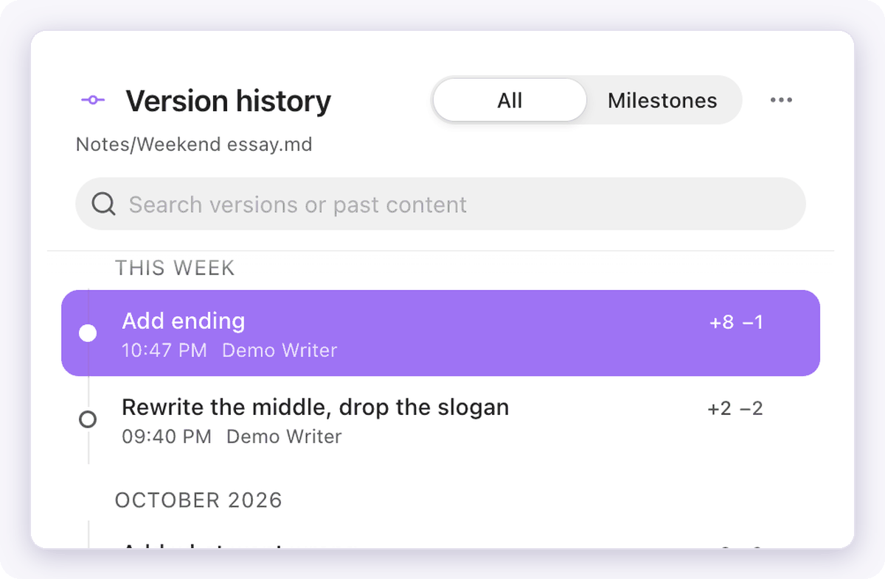
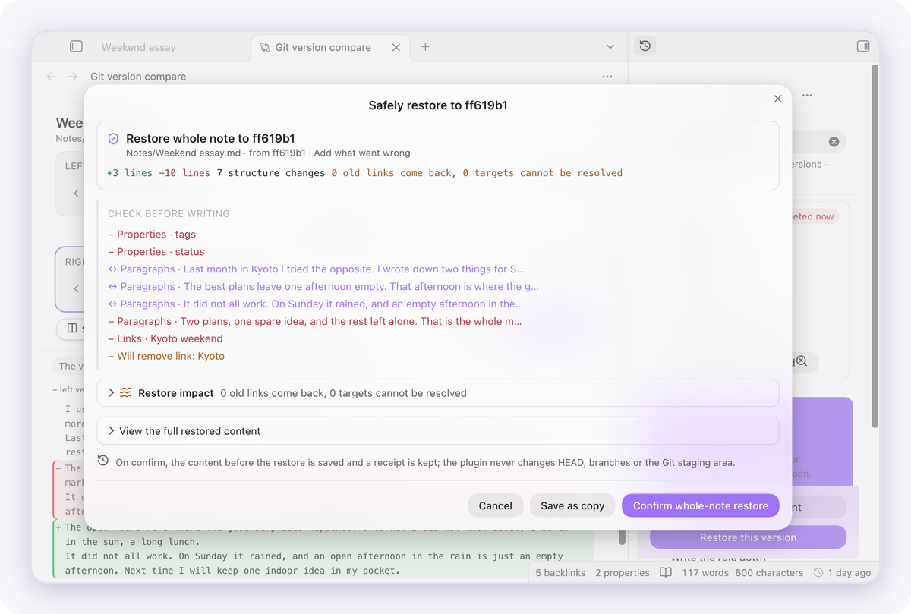

<p align="right"><a href="README.md">English</a> · <a href="README_zh.md">中文</a></p>

<p align="center"><picture><source media="(prefers-color-scheme: dark)" srcset="assets/readme/icon-dark.svg"></picture></p>

<picture>
  <source media="(prefers-color-scheme: dark)" srcset="assets/readme/hero-dark.svg">
  
</picture>

<p align="center"><a href="https://community.obsidian.md/plugins/git-note-history"><b>Obsidian からインストール</b></a></p>

<picture>
  <source media="(prefers-color-scheme: dark)" srcset="assets/readme/demo-dark.gif">
  
</picture>

<picture>
  <source media="(prefers-color-scheme: dark)" srcset="assets/readme/cards-dark.svg">
  
</picture>

## 3 ステップで始める

1. 「Settings → Community plugins → Browse」で **Git Note History** を検索し、インストールして有効にします。
2. ノートを開き、左のリボンにある時計のアイコンを押します。
3. バージョンを選び、**「Compare with current」** を押します。

まだ Git を使っていない場合は、コマンドパレットで **「See an example (no repository needed)」** を実行できます。

**動作環境** デスクトップ版 Obsidian 1.13 以降、インストール済みの Git、Git リポジトリ内の保管庫が必要です。**費用** 無料です。アカウント、ネットワーク通信、利用状況の送信はありません。履歴の閲覧では Git を読み取るだけで、プラグインがコミットすることはありません。

うまく動かないときは、[AI アシスタントに貼る確認用プロンプト](docs/troubleshooting.ja.md)をどうぞ。

## その他

<details>
<summary><b>機能一覧</b></summary>

<picture>
  <source media="(prefers-color-scheme: dark)" srcset="assets/readme/restore-dark.png">
  
</picture>

- **タイムライン：** 現在のノートの履歴を右サイドバーに日付別で表示します。追加・削除行数と、自分で名前を付けたマイルストーン（送信済み、提出済み、確認済みなど）も表示します。バージョンを選ぶと、下部のバーから「Compare with current」や「Restore this version」を使えます。
- **比較：** 任意の 2 版を、左右の差分、統合差分、Markdown の表示に沿った差分、2 つのプレビュー、構造ビューで比較できます。構造ビューはプロパティ、見出し、リスト、タスク、表、コールアウト、コード、ウィキリンクに対応します。ペインが狭いと統合差分に切り替わります。
- **一部分の復元：** 段落や変更ブロックを戻したり、複数のバージョンから選んだブロックをまとめたりできます。書き込む前に、結合した結果とリンク切れの可能性を確認できます。
- **書き込み前の確認：** 復元の直前にノートを再確認します。プレビュー後に変更されていたら、復元を中止します。復元は 12 回分まで取り消せます。取り消し前にノートを編集していた場合も中止します。
- **競合の解決：** ノートの Git マージ競合を 3 つのペインで比較します。変更するのは作業ファイルだけです。
- **段落の履歴：** カーソル位置の段落を、後で削除されたバージョンも含めてたどれます。
- **過去の文章を検索：** 以前あった一文を探し、追加・削除された時点を確認できます。長い検索には進捗が表示され、途中で停止できます。
- **ステータスバー：** 現在のノートが最後にコミットされてからの時間を表示します。未コミットの変更があると点が付きます。
- **バージョンへのリンク：** バージョンのメニューで「Copy version link」を選びます。後でリンクを開くと、その版と現在のノートを比較できます。

実験機能（レビュー受信箱、作業イベント、知識の追跡、出典レンズ、履歴への注釈、履歴の状態確認、知識グラフの再生、履歴サンドボックス、履歴ソース）は初期状態では無効です。設定の「Show lab tools」で有効にできます。全機能の一覧は中国語の [docs/FEATURES_zh.md](docs/FEATURES_zh.md) にあります。

</details>

<details>
<summary><b>安全性・プライバシー・アクセスするデータ</b></summary>

| プラグインが行うこと | 行わないこと |
|---|---|
| `git log`、`git show`、`git diff`、`git status` などの読み取りコマンドを実行します | コミット、push、pull、fetch、reset、revert、ステージング、リポジトリの初期化、現在の保管庫のブランチ切り替え |
| 復元を確認したときだけ、再確認してから作業ファイルに書き込みます | 自動でリポジトリに書き込むこと |
| マイルストーン、スナップショット、取り消し履歴、設定を保管庫内のプラグインデータに保存します | ネットワークへのデータ送信 |

**ネットワーク：** プラグインからネットワークリクエストは送りません。履歴を読む Git コマンドには `GIT_NO_LAZY_FETCH=1` と `GIT_OPTIONAL_LOCKS=0` を設定します。履歴の読み取りでリモートから取得したり、インデックスを書き換えたりしません。

**保管庫の外のファイル：** リポジトリが保管庫の親フォルダーから始まる場合は、Git でそこを読み取ります。実験機能の「履歴サンドボックス」を作るときだけ、古い保管庫の状態をユーザーごとのアプリケーションデータ領域にコピーします。macOS はユーザーの Application Support、Windows はローカルアプリケーションデータ、Linux はローカルデータのディレクトリです。サンドボックスの作成・削除では、リポジトリの Git worktree メタデータも更新します。現在の保管庫のブランチは切り替えません。

#### アクセスするデータ

[コミュニティディレクトリ](https://community.obsidian.md/plugins/git-note-history)のスコアカードには、警告 2 件とその他の項目 2 件が記載されています。いずれもネットワーク通信のためのものではありません。

| スコアカードの項目 | 必要な理由 | 使用する場所 |
|---|---|---|
| **Shell Execution** （`child_process`） | Git の履歴を読むため、設定した `git` プログラムを起動します。シェルを介さず引数のリストを渡すため、ノート本文やファイル名をコマンドとして実行しません。 | 履歴の読み取り（`git log`、`show`、`diff`、`status`、`blame`）と履歴サンドボックスです。サンドボックスでは `git worktree` で古い状態を取り出します。 |
| **Direct Filesystem Access** （`fs`） | リポジトリが保管庫より上にある場合、保管庫の API では参照できません。 | リポジトリの場所の特定と、移動したリポジトリの存在確認に使います。サンドボックス作成時には上記のアプリケーションデータ領域にコピーを書き込み、サンドボックス削除時にはそのコピーを削除します。 |
| **Vault Enumeration** （`getMarkdownFiles`） | 復元で見出しやブロックがなくなると、別のノートからのリンクが切れる可能性があります。Obsidian が保持するリンク索引で確認します。 | 復元プレビューのリンク確認と「Link impact」ビューの被リンク数です。Obsidian のキャッシュからリンクを読み取り、ノート本文は読みません。 |
| **Clipboard Access** | コピーボタンに使います。クリップボードへの書き込みだけで、読み取りはしません。 | バージョンリンク、コミットハッシュ、ブロックや版全体の文章、復元結果、ファイルパス、レビューパックのコピーボタンを押したときだけです。 |

</details>

<details>
<summary><b>まだ Git を使っていない場合</b></summary>

Git Note History は既存の履歴を読み取ります。記録を始める手順です。

1. [git-scm.com](https://git-scm.com/downloads) から Git をインストールします。
2. コミュニティプラグインの Obsidian Git を入れて、その案内に従って設定します。手動の場合は、保管庫フォルダーでターミナルを開き、`git init`、`git add -A`、`git commit -m "First snapshot"` を順に実行します。
3. 後で戻れるバージョンを残したいときにコミットします。Obsidian Git では定期的なコミットも設定できます。

Git Note History がこれらのコマンドを代わりに実行することはありません。

</details>

<details>
<summary><b>言語とテーマ</b></summary>

実験機能を含め、画面の言語は Obsidian の設定に従います。中国語の設定では中国語、それ以外では英語で表示します。

色、角の丸み、余白はテーマの変数から取得し、スタイルはプラグインのビュー内にだけ適用します。Default、Minimal、Blue Topaz、AnuPpuccin のライト・ダーク両モードで、狭いサイドバー、左右の差分（行番号、横幅、長いパス）、ドロップダウンを確認済みです。システムの「透明度を下げる」「視差効果を減らす」にも従います。

</details>

<details>
<summary><b>制限</b></summary>

- Git を実行するため、デスクトップ版のみ対応します。
- 読み取る履歴は、初期設定でノートごとに 100 コミットまでです。設定で変更できます。
- 浅いクローン、部分クローン、LFS ポインター、欠けたオブジェクトはその状態を表示します。自動修復はしません。
- 名前の変更は `git log --follow` で追跡します。

</details>

<details>
<summary><b>開発とリリースファイルの検証</b></summary>

```bash
npm ci
npm run check          # 型チェック、ビルド、公式ルールの lint、テスト
npm run package:release
```

TypeScript と esbuild を使い、Vitest でテストし、公式の `eslint-plugin-obsidianmd` ルールで検査します。チェック方法と問題の報告は [CONTRIBUTING.md](CONTRIBUTING.md)、リリースの確認項目は [RELEASING.md](RELEASING.md)、変更履歴は [CHANGELOG.md](CHANGELOG.md) を参照してください。

0.12.1 以降の配布ファイルには GitHub のビルド証明が付いています。`gh attestation verify main.js -R Rexxall/obsidian-git-history-view` で検証できます。

</details>

MIT ライセンス
