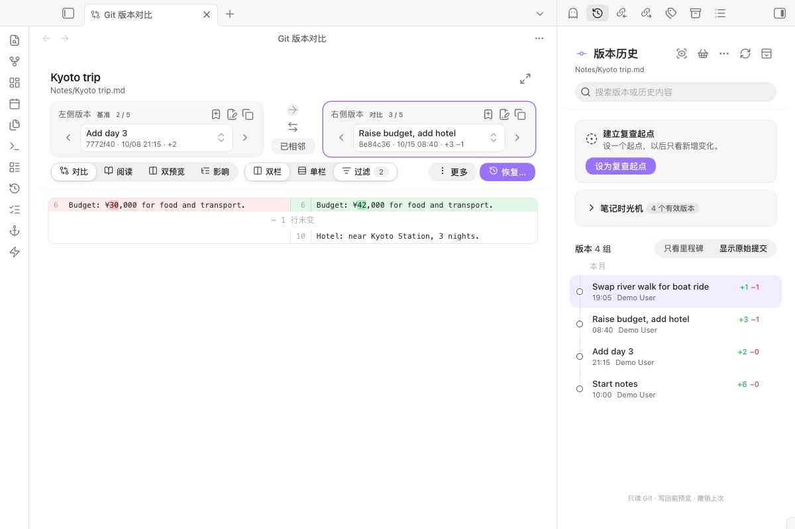
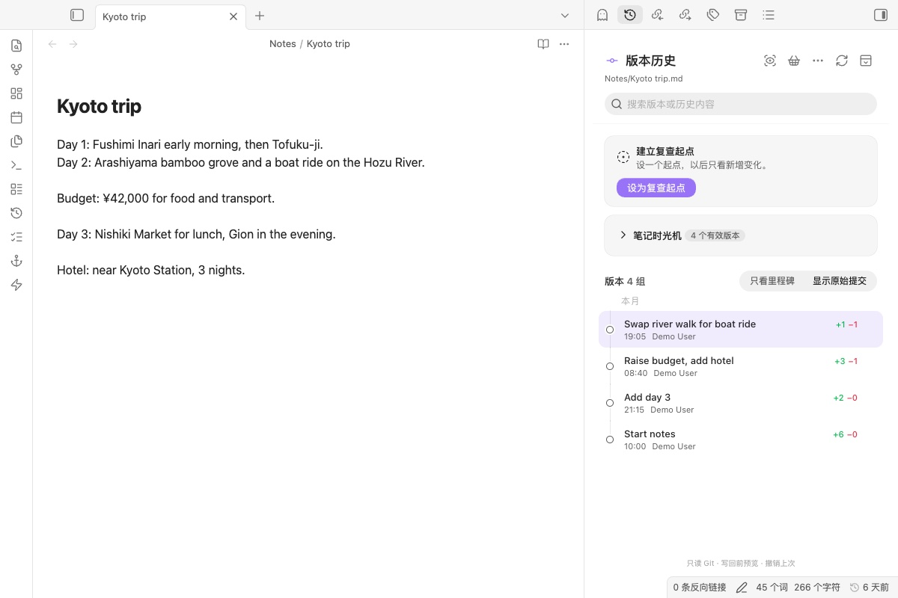
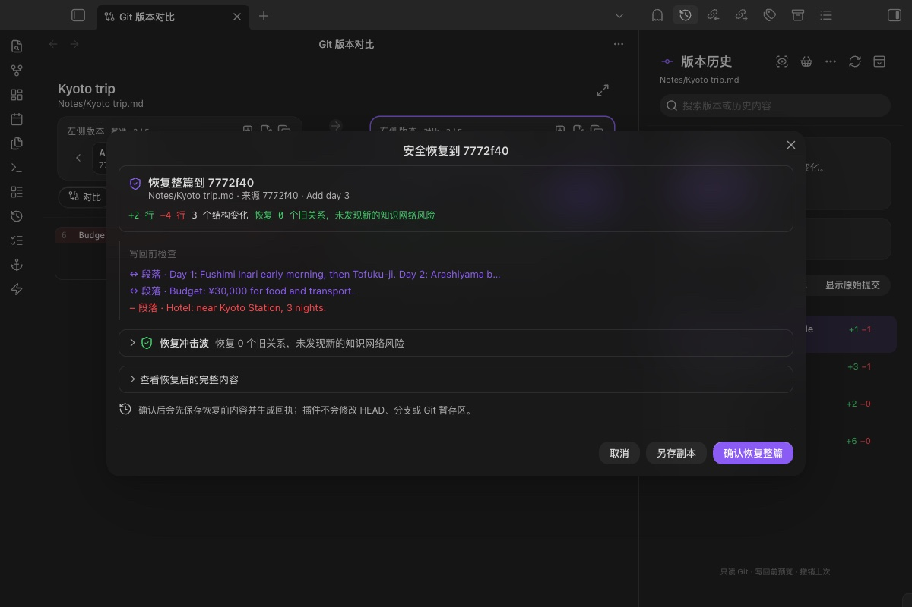

# Git Note History

**See how a note changed, and take back only the part you need.**

在 Obsidian 里查看一篇笔记的 Git 历史，比较任意两个版本，只把需要的那一段、那一块或整篇安全地取回来。

<picture>
  <source media="(prefers-color-scheme: dark)" srcset="docs/screenshots/compare-dark.jpg">
  
</picture>

> Desktop only. Your vault has to be inside a Git repository (for example one kept by the Obsidian Git plugin or a daily backup script). This plugin only *reads* Git; it never commits, pushes, checks out or resets.

## Why

Daily Git backups mean every old version of a note is still there. The problem is getting one line back: restoring a whole file overwrites everything written since. Git Note History treats a note's history as something to read and pick from, not something to roll back wholesale.

- **Timeline** of the current note in the right sidebar, grouped by day, with `+/-` counts and milestones you name yourself (*sent*, *submitted*, *confirmed*).
- **Compare** any two versions: side by side, unified diff, rendered Markdown changes, two previews, or a structure view that understands YAML properties, headings, lists, tasks, tables, callouts, code and wiki links.
- **Restore just a part.** Bring back a paragraph, a change block, or several blocks collected from different versions, after a preview that shows the merged result and any links that would break.
- **Safe writes.** Right before writing, the note is compared with what you saw; if it changed in between, the restore stops. Every restore can be undone (12 steps), and undo also stops if you have edited since.
- **Conflict resolver** for Git merge conflicts in a note, three panes, writes only the working file.
- **Paragraph history** for the paragraph under the cursor, including versions where it was later deleted.
- **Search old content**: find a sentence that used to exist, see when it appeared and when it was removed, and open the versions on either side.
- **Status bar**: how long ago the active note was last committed, with a dot when it has uncommitted edits. Click it to open the timeline.
- **Compare with last commit**: one command shows what you changed since the last backup.
- **Version links**: right-click a version, choose *Copy version link*, and paste it into any note, for example next to "sent to the professor on 26 October". Clicking the link opens that version against the current note.





## Lab tools

Behind a single switch in settings (*Show lab tools*) are the more experimental views: a review inbox for changed notes, work-event view across files, knowledge-boundary tracing, content-age lens, provenance lens that reads commit trailers, version annotations, history health checks, knowledge-graph playback, historical sandboxes (read-only time capsules of the whole vault at a commit), and a map of every history source (Git, local snapshots, File Recovery, Sync). They are off by default so the command palette stays short.

The full feature list, in Chinese, is in [docs/FEATURES_zh.md](docs/FEATURES_zh.md).

## Quick start

1. Install **Git Note History** from *Settings → Community plugins → Browse*, or download `main.js`, `manifest.json` and `styles.css` from the latest release into `<vault>/<config folder>/plugins/git-note-history/` (the config folder is `.obsidian` unless you changed it).
2. Enable it in *Settings → Community plugins*.
3. Open a Markdown note and run **Open Git history of the current note** (command palette, ribbon icon, the file menu, or click the status bar item).
4. Click a version to compare it with the current note. In the comparison, hover a change block and choose *Restore this block*, or use *Recovery basket* to collect blocks from several versions first.

Looks: a light, Apple-style "glass" interface. The timeline, cards and diffs are solid; only the bars that content scrolls under and the dialogs are translucent. Colours come from your Obsidian theme and accent colour, light and dark follow Obsidian, and with *Reduce transparency* (macOS) the glass turns solid. *Reduce motion* switches the animations off.

Language: commands, menus, settings and the status bar follow Obsidian's language (Chinese or English). The timeline, compare and restore views are currently in Simplified Chinese; an English version of those views is planned.


Requirements: Obsidian 1.8 or later on macOS, Windows or Linux; `git` on your PATH (or set the path in settings).

## Safety and privacy

| What the plugin does | What it never does |
|---|---|
| Runs `git log`, `git show`, `git diff`, `git status` and similar read-only commands on your repository | Commit, push, pull, fetch, checkout, reset, revert, stage, or move HEAD |
| Writes to the working file only when you confirm a restore, after re-checking the file | Write anything to the repository on its own |
| Stores milestones, snapshots, undo history and settings in this vault's plugin data | Send anything over the network |
| Reads Obsidian's own File Recovery / Sync only through documented, read-only paths | Open their private databases |

**Network:** none. The plugin makes no network requests and has no telemetry. Every Git call runs with `GIT_NO_LAZY_FETCH=1` and `GIT_OPTIONAL_LOCKS=0`, so reading history never triggers a fetch from a remote or rewrites the index.

**Files outside the vault:** the Git repository may start in a folder above your vault (for example when a whole Documents folder is under Git); the plugin reads that repository with `git`. The optional lab tool *historical sandboxes* writes copies of an old vault state to a per-user application data folder (on macOS `~/Library/Application Support/Git Note History`), outside the current vault, so they can be opened as their own vault. It only runs when you create a sandbox. Nothing else outside the vault is read or written.

Try it on a test vault first.

## Limits

- Desktop only (it spawns `git`).
- Large repositories: history reads are bounded (default 100 commits per note, configurable); long histories show a clear "more available" state rather than loading forever.
- Shallow or partial clones, LFS pointers and missing objects are reported as such; the plugin does not try to repair them.
- Renames are followed with `git log --follow`; copies and moves detected by Git are shown, heuristics are not invented.

## Development

```bash
npm install
npm run check          # type-check, tests, build
npm run package:release
```

TypeScript + esbuild, tested with Vitest (247 tests) and linted with the official `eslint-plugin-obsidianmd` rules (`npm run lint`). See [RELEASING.md](RELEASING.md) for the release checklist and [CHANGELOG.md](CHANGELOG.md) for versions. Design notes live in [docs/](docs/).

## License

MIT

---

## 中文说明

**这是什么：** 一个 Obsidian 桌面插件。笔记放在 Git 仓库里（比如用 Obsidian Git 或每日备份脚本），它就能在侧栏显示这篇笔记的全部历史版本，任选两个版本比较，并把需要的内容取回来。

**为什么做：** 每天自动备份，旧版本都在；但要找回其中一段时，整篇恢复会冲掉后来写的内容。所以这个插件把“恢复”的单位从整篇改成一段、一个修改块，甚至从不同版本各取一块合并回来。

**安全：** 只读 Git，从不 commit、push、checkout、reset。写回前会再比对一次笔记，中途被改过就停下；每次恢复都能撤销。

**用法：** 在“设置 → 第三方插件 → 浏览”里搜索 Git Note History 安装；或把 `main.js`、`manifest.json`、`styles.css` 放进 `<库>/.obsidian/plugins/git-note-history/`。启用后打开一篇笔记，运行“打开当前笔记的 Git 历史”，或点状态栏上的“几小时前”。

**外观：** 0.10 换成苹果“玻璃”风：时间线、卡片、对比内容是实底，只有顶栏和弹窗是半透明玻璃；颜色跟随你的主题和强调色，深浅色跟随 Obsidian；系统打开“降低透明度”时玻璃自动变实底。原来的“纸与墨外观”已删除。

**0.10 新增：** 状态栏显示当前笔记上次提交是多久以前、有没有未提交修改；“将当前笔记与上次提交对比”一条命令看清这次改了什么；时间线右键“复制版本链接”，粘进任何笔记，点一下就打开那一版和当前笔记的对比。

**网络与库外文件：** 不联网、无遥测。Git 仓库可能在库的上层目录；实验功能“历史沙盒”只在你创建沙盒时把旧版本整库复制到系统的应用数据目录（macOS 为 `~/Library/Application Support/Git Note History`），其余不读写库外文件。

**实验功能：** 复查收件箱、工作事件、知识边界追踪、来源可信度镜头、版本批注、历史健康中心、知识图谱时间机、历史沙盒等，默认关闭，在设置里打开“显示实验功能”即可使用。完整功能清单见 [docs/FEATURES_zh.md](docs/FEATURES_zh.md)。
