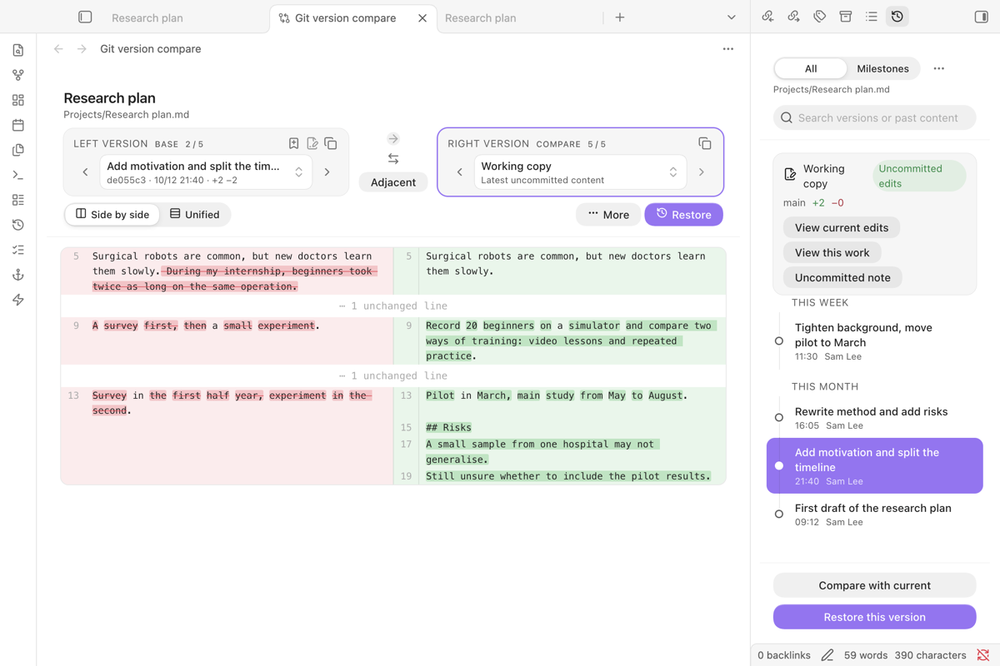
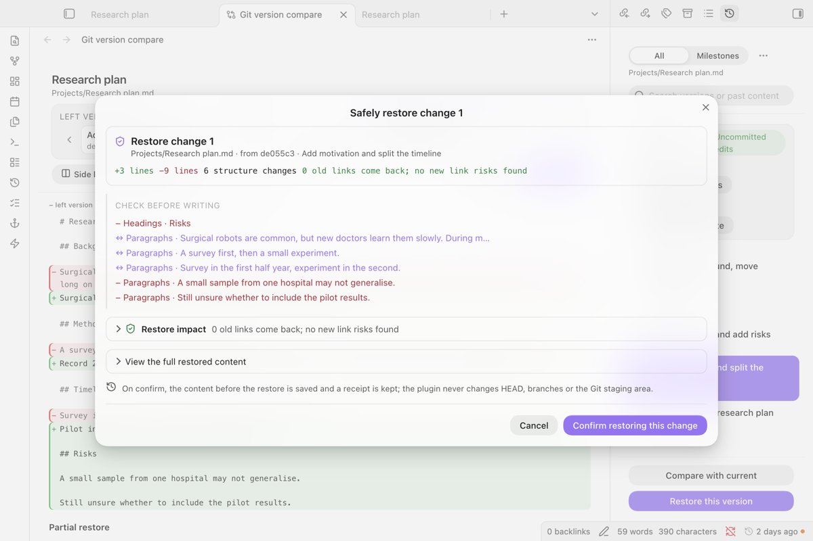
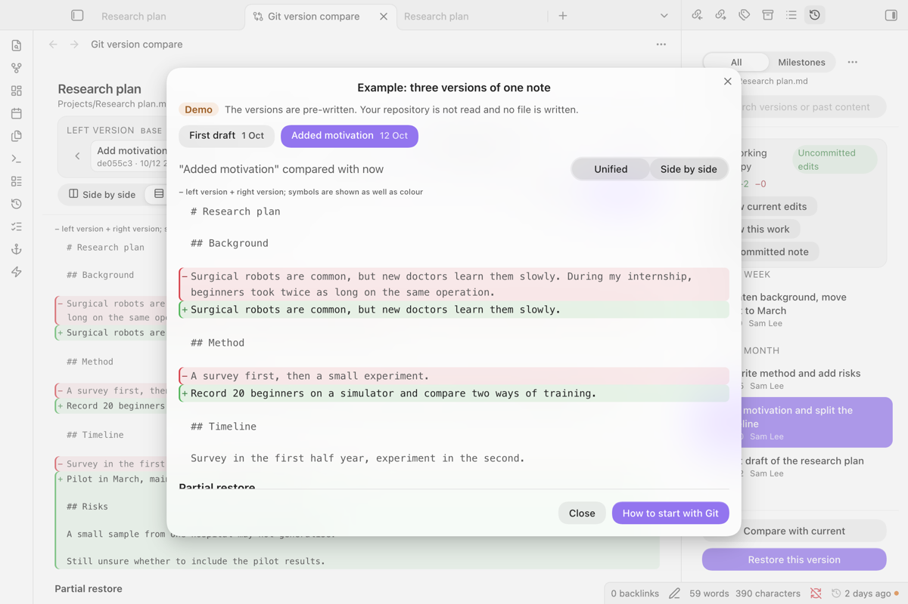

# Git Note History

**See how a note changed, and take back only the part you need.**

[中文说明](README_zh.md)

Browse the Git history of the note you are editing, compare any two versions, and restore one paragraph, one change or the whole note, with a preview first and undo afterwards. It only reads Git and never commits for you.



*The timeline of the open note on the right; an older version compared with the current note on the left.*

## Start here

1. Install **Git Note History** from *Settings → Community plugins → Browse* and enable it.
2. Open a Markdown note and click the clock icon in the ribbon (or run **Open Git history of the current note**).
3. Pick a version and choose *Compare with current*. To bring something back, open *Unified*, find the change and choose *Restore this change*.

No Git yet? Run **See an example (no repository needed)**: three pre-written versions of a note, compared and restored in memory, so you can see what the plugin does before setting anything up. If the vault is not in a repository, has no commits, or a note is not tracked or is ignored, the sidebar says which one it is and offers one read-only next step.

## What it needs and what it costs

- **Needs:** Obsidian 1.13 or later on desktop (macOS, Windows, Linux), Git installed, and a vault inside a Git repository (kept by the Obsidian Git plugin, a backup script or by hand).
- **Costs:** nothing. No account, no network, no telemetry.

## More pictures



*Before anything is written, the restore preview lists what changes and checks links; you confirm, and can undo.*



*The example works without a repository and is clearly marked as a demo.*

## Features

- **Timeline** of the current note in the right sidebar, grouped by day, with `+/-` counts and milestones you name yourself (*sent*, *submitted*, *confirmed*). Pick a version, then *Compare with current* or *Restore this version* from the bar at the bottom.
- **Compare** any two versions: side by side, unified diff, rendered Markdown changes, two previews, or a structure view that understands properties, headings, lists, tasks, tables, callouts, code and wiki links. A narrow pane switches to the unified diff by itself.
- **Restore just a part.** Bring back a paragraph, a change block, or several blocks collected from different versions, after a preview that shows the merged result and any links that would break.
- **Safe writes.** Right before writing, the note is compared with what you saw; if it changed in between, the restore stops. Every restore can be undone (12 steps), and undo also stops if you have edited since.
- **Conflict resolver** for Git merge conflicts in a note, three panes, writes only the working file.
- **Paragraph history** for the paragraph under the cursor, including versions where it was later deleted.
- **Search old content**: find a sentence that used to exist, see when it appeared and when it was removed. A long search shows its progress and can be stopped.
- **Status bar**: how long ago the active note was last committed, with a dot when it has uncommitted edits.
- **Version links**: *Copy version link* in a version's menu; clicking the link later opens that version against the current note.

Lab tools (review inbox, work events, knowledge tracing, provenance lens, annotations, history health, knowledge-graph playback, historical sandboxes, history sources) sit behind *Show lab tools* in settings and are off by default. Their views are in Chinese for now. The full feature list, in Chinese, is in [docs/FEATURES_zh.md](docs/FEATURES_zh.md).

## Language and themes

Commands, settings, the timeline, compare and restore views, errors and empty states follow Obsidian's language: Chinese, or English for every other language.

Colours, radii and spacing come from your theme's variables, and styles only apply inside the plugin's own views. Checked in light and dark mode with Default, Minimal, Blue Topaz and AnuPpuccin, including a narrow sidebar, the side-by-side diff (line numbers, horizontal space, long paths) and dropdowns. *Reduce transparency* and *Reduce motion* are respected.

## Safety and privacy

| What the plugin does | What it never does |
|---|---|
| Runs `git log`, `git show`, `git diff`, `git status` and similar read-only commands | Commit, push, pull, fetch, checkout, reset, revert, stage, initialise a repository, or move HEAD |
| Writes to the working file only when you confirm a restore, after re-checking the file | Write anything to the repository on its own |
| Stores milestones, snapshots, undo history and settings in this vault's plugin data | Send anything over the network |

**Network:** none. Every Git call runs with `GIT_NO_LAZY_FETCH=1` and `GIT_OPTIONAL_LOCKS=0`, so reading history never fetches from a remote or rewrites the index.

**Files outside the vault:** the repository may start in a folder above your vault; the plugin reads it with `git`. The lab tool *historical sandboxes* writes copies of an old vault state to a per-user application data folder (on macOS `~/Library/Application Support/Git Note History`), only when you create a sandbox. Nothing else outside the vault is read or written.

### Data flow

The community directory lists two warnings for this plugin. Both are needed to read Git, and neither touches the network.

| Warning | Why it is needed | Where it is used |
|---|---|---|
| **Shell Execution** (`child_process`) | Git history lives in the repository, not in the vault, so the plugin starts the `git` program you set in the settings. It calls `git` directly with a list of arguments, never through a shell, so nothing in a note or file name can run as a command. | Reading history (`git log`, `show`, `diff`, `status`, `blame`), and the lab tool *historical sandboxes*, which also runs `git worktree` to check out an old state. |
| **Direct Filesystem Access** (`fs`) | The vault API cannot see folders above the vault, where the repository may start. | Resolving the repository folder and checking that a moved repository still exists; and, only when you create a historical sandbox, writing and later removing its copy in the application data folder named above. |

## Starting with Git

Git Note History reads history that already exists. To start one:

1. Install Git from [git-scm.com](https://git-scm.com/downloads).
2. Either install the Obsidian Git community plugin and follow its setup, or open a terminal in your vault folder and run `git init`, then `git add -A` and `git commit -m "First snapshot"`.
3. Commit again whenever you want a version you can come back to. Obsidian Git can do this on a timer.

The plugin itself never runs any of these commands for you.

## Limits

- Desktop only (it runs `git`).
- History reads are bounded (100 commits per note by default, configurable).
- Shallow or partial clones, LFS pointers and missing objects are reported as such; the plugin does not try to repair them.
- Renames are followed with `git log --follow`.

## Development

```bash
npm ci
npm run check          # type-check, build, official lint, tests
npm run package:release
```

TypeScript + esbuild, tested with Vitest and linted with the official `eslint-plugin-obsidianmd` rules. See [RELEASING.md](RELEASING.md) for the release checklist and [CHANGELOG.md](CHANGELOG.md) for versions.

## License

MIT
