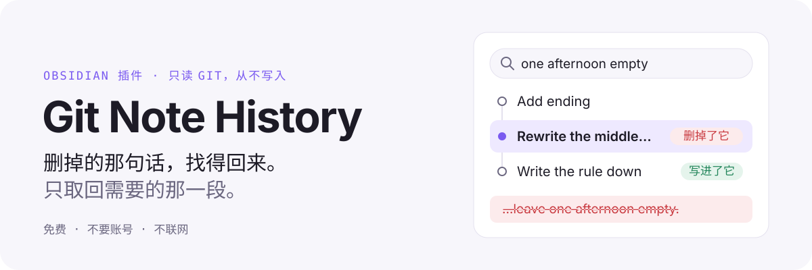
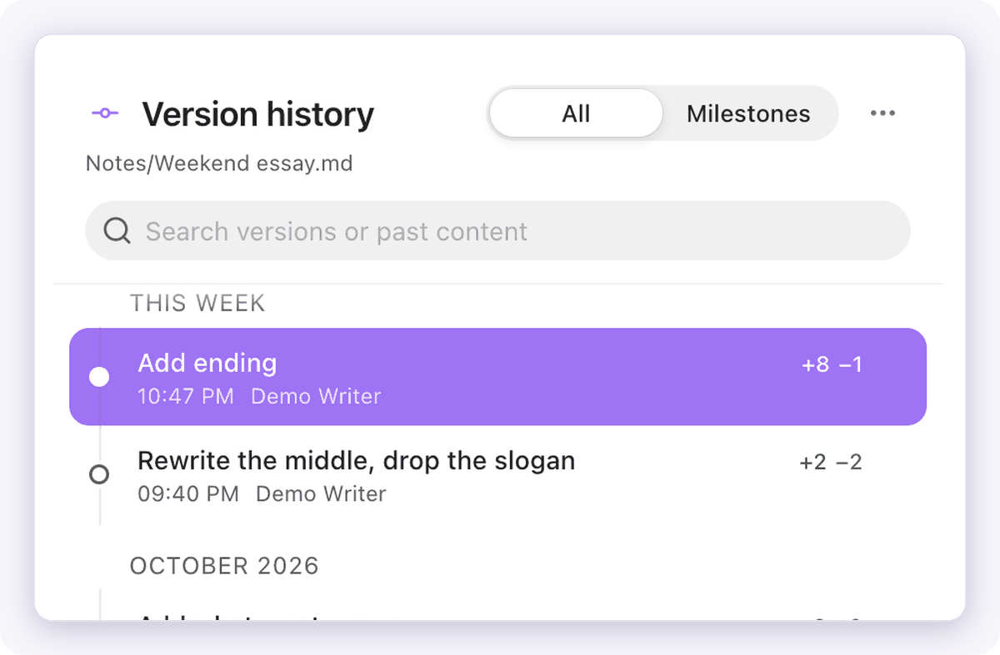
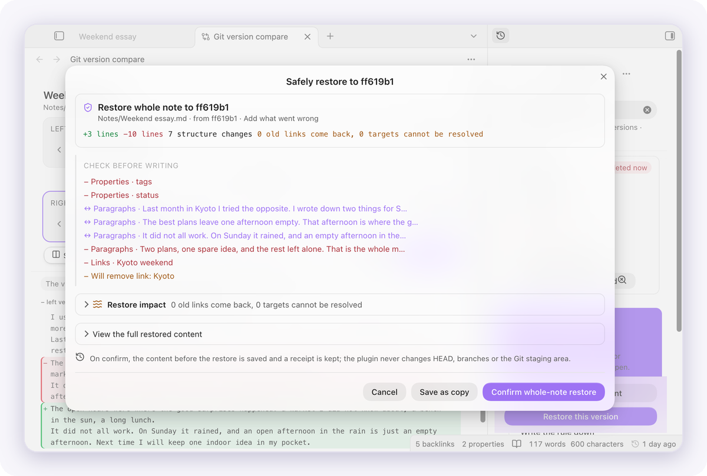

<p align="right"><a href="README.md">English</a></p>

<picture>
  <source media="(prefers-color-scheme: dark)" srcset="assets/readme/hero-zh-dark.svg">
  
</picture>

<p align="center"><a href="https://community.obsidian.md/plugins/git-note-history"><b>在 Obsidian 里安装</b></a></p>

<picture>
  <source media="(prefers-color-scheme: dark)" srcset="assets/readme/demo-dark.gif">
  
</picture>

<picture>
  <source media="(prefers-color-scheme: dark)" srcset="assets/readme/cards-zh-dark.svg">
  
</picture>

## 三步上手

1. 在“设置 → 第三方插件 → 浏览”里搜索 **Git Note History**，安装并启用。
2. 打开一篇笔记，点左侧功能区的时钟图标。
3. 选一个版本，点“和当前比较”。

还没用过 Git？在命令面板运行“看示例（不读仓库）”。

**需要** 桌面版 Obsidian 1.13 或更新、电脑装了 Git、库在 Git 仓库里。**费用** 不要钱：不用注册，不联网，没有统计上报。插件只读 Git，从不替你提交。

## 其余内容

<details>
<summary><b>全部功能</b></summary>

<picture>
  <source media="(prefers-color-scheme: dark)" srcset="assets/readme/restore-dark.png">
  
</picture>

- **时间线：** 右侧栏显示当前笔记的版本，按日期分组，带增删行数和你自己命名的里程碑（已发送、材料已提交、已确认）。选中一个版本后，用底部的“和当前比较”“恢复这一版”。
- **比较：** 任意两个版本可以双栏、单栏、按排版后的内容、双预览，或按结构（属性、标题、列表、任务、表格、标注块、代码、双链）比较。窗口窄时自动换成单栏。
- **只取回一部分：** 找回一段、一处修改，或从不同版本各取几块合在一起；写回前预览合并结果和会断的链接。
- **安全写回：** 写之前再核对一次笔记，中间被改过就停下。每次恢复都能撤销（12 步），撤销前你又改过笔记也会停下。
- **冲突解决：** 一篇笔记出现 Git 合并冲突时，三栏对照选择，只改工作区文件。
- **段落历史：** 光标所在段落的历史，包括它后来被删掉的版本。
- **搜索旧内容：** 找一句以前写过的话，看它什么时候出现、什么时候被删。搜索久时显示进度，可以停止。
- **状态栏：** 当前笔记上次提交是多久以前，有未提交修改时带一个点。
- **版本链接：** 版本菜单里“复制版本链接”，以后点这个链接就打开那一版和当前笔记的对比。

实验功能（复查收件箱、工作事件、知识边界追踪、来源镜头、版本批注、历史健康、知识图谱时间机、历史沙盒、历史来源）默认关闭，在设置里打开“显示实验功能”即可使用。完整功能清单见 [docs/FEATURES_zh.md](docs/FEATURES_zh.md)。

</details>

<details>
<summary><b>安全、隐私，以及插件会碰什么</b></summary>

| 插件会做的 | 插件不会做的 |
|---|---|
| 运行 `git log`、`git show`、`git diff`、`git status` 这类只读命令 | 提交、推送、拉取、获取、切换、重置、还原、暂存、初始化仓库、移动 HEAD |
| 只在你确认恢复后写当前文件，写前再核对一次 | 自己往仓库里写任何东西 |
| 把里程碑、快照、撤销记录和设置存在这个库的插件数据里 | 联网发送任何内容 |

**联网：** 不联网。每次调用 Git 都带 `GIT_NO_LAZY_FETCH=1` 和 `GIT_OPTIONAL_LOCKS=0`，读历史不会从远端拉取，也不会改写索引。

**库外文件：** Git 仓库可能从库的上层目录开始，插件用 `git` 读它。实验功能“历史沙盒”只在你创建沙盒时，把旧版本的整个库复制到系统的应用数据目录（macOS 为 `~/Library/Application Support/Git Note History`，Windows 为 `%LOCALAPPDATA%\Git Note History`，Linux 为 `~/.local/share/git-note-history`）。除此之外不读写库外文件。

#### 插件会碰什么

社区目录的评分卡给本插件列了两条警告和两条其他条目，都不联网。

| 评分卡条目 | 为什么要用 | 只在哪里用 |
|---|---|---|
| **执行外部程序**（`child_process`） | Git 历史在仓库里，不在库里，所以插件要启动你在设置里填的 `git` 程序。它直接把参数列表交给 `git`，不经过 shell，笔记内容和文件名都不会被当成命令执行。 | 读历史（`git log`、`show`、`diff`、`status`、`blame`）；实验功能“历史沙盒”另外用 `git worktree` 取出旧版本。 |
| **直接访问文件系统**（`fs`） | 仓库可能从库的上层目录开始，库的接口看不到那里。 | 确定仓库目录、确认搬走的仓库是否还在；只在你创建历史沙盒时，在上面说的应用数据目录里写入沙盒副本，删除沙盒时再移除。 |
| **遍历库文件**（`getMarkdownFiles`） | 恢复旧版本可能删掉别的笔记链接着的标题或段落。为了提前提醒，插件要查 Obsidian 本来就为每篇笔记维护的链接索引。 | 恢复预览里的链接检查，以及“链接影响”视图里的反链数。只从 Obsidian 的缓存里读链接，不读笔记正文。 |
| **剪贴板** | 复制按钮。插件只往剪贴板写，从不读取。 | 只在你点复制按钮时：版本链接、提交哈希、一段或整个版本的文字、恢复结果、文件路径、审阅包。 |

</details>

<details>
<summary><b>还没用过 Git？从这里开始</b></summary>

Git Note History 只读已有的历史。要开始记录：

1. 从 [git-scm.com](https://git-scm.com/downloads) 安装 Git。
2. 装 Obsidian Git 第三方插件并按它的引导设置；或者在库文件夹打开终端，依次运行 `git init`、`git add -A`、`git commit -m "First snapshot"`。
3. 想留一个能回来的版本时就再提交一次。Obsidian Git 可以定时自动提交。

这些命令插件一条都不会替你运行。

</details>

<details>
<summary><b>语言和主题</b></summary>

整个界面（包括实验功能）跟随 Obsidian 的语言：中文，其他语言一律用英文。

颜色、圆角、间距都取自主题变量，样式只作用在插件自己的视图里。在 Default、Minimal、Blue Topaz、AnuPpuccin 四个主题的浅色和深色下测过：窄侧栏、双栏 diff（行号栏、横向空间、长路径）、下拉框。系统的“降低透明度”“减少动态效果”都会照做。

</details>

<details>
<summary><b>限制</b></summary>

- 只能在桌面版用（要调用 `git`）。
- 每篇笔记默认读最近 100 次提交，可以在设置里改。
- 浅克隆、部分克隆、LFS 指针和缺失对象会如实提示，插件不会去修复。
- 改名用 `git log --follow` 跟踪。

</details>

<details>
<summary><b>开发与核验发布文件</b></summary>

```bash
npm ci
npm run check          # 类型检查、构建、官方规则检查、测试
npm run package:release
```

TypeScript + esbuild，用 Vitest 测试，用官方 `eslint-plugin-obsidianmd` 规则检查。检查命令和提 issue 的方式见 [CONTRIBUTING.md](CONTRIBUTING.md)，发布清单见 [RELEASING.md](RELEASING.md)，版本记录见 [CHANGELOG.md](CHANGELOG.md)。

从 0.12.1 起，Release 附件带 GitHub 构建认证，可用 `gh attestation verify main.js -R Rexxall/obsidian-git-history-view` 核验。

</details>

MIT 许可
