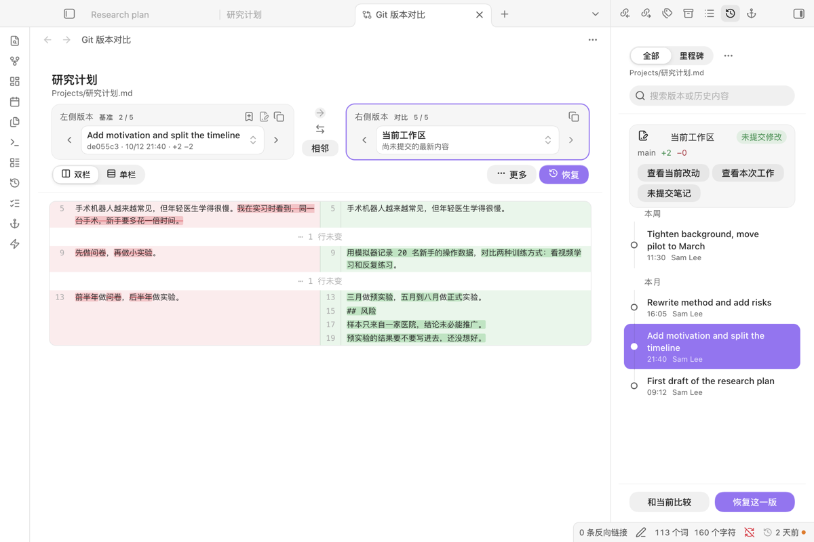
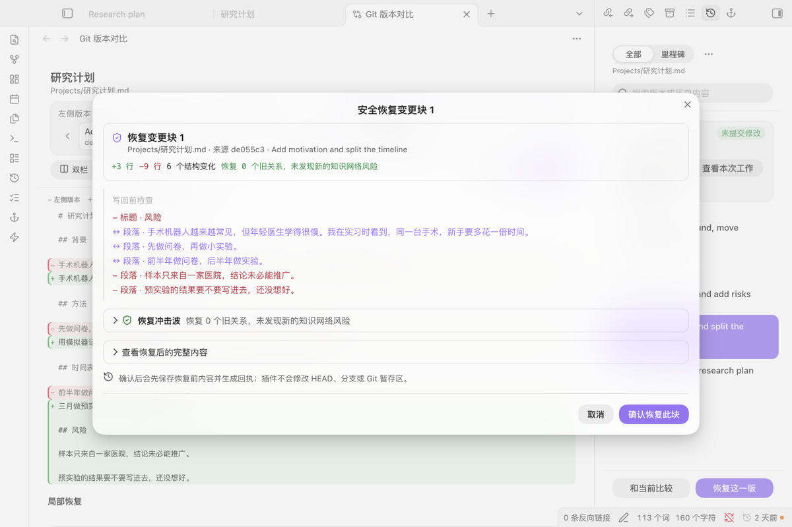
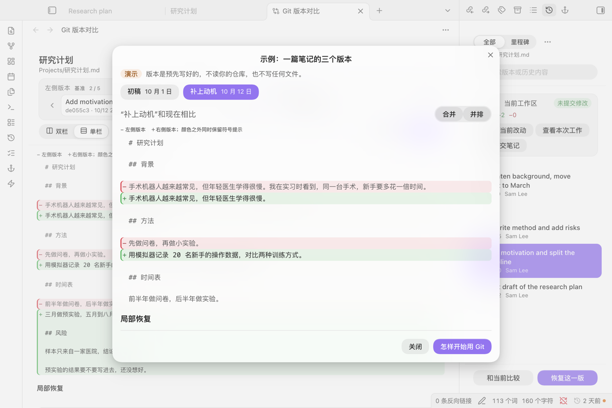

# Git Note History

**看清一篇笔记怎么变过来的，只取回需要的那一段。**

[English](README.md)

在 Obsidian 里查看正在编辑的这篇笔记的 Git 历史，任选两个版本比较，把一段、一处修改或整篇恢复回来；恢复前先预览，恢复后可以撤销。插件只读 Git，不会替你提交。



*右边是当前笔记的时间线，左边是旧版本和当前笔记的对比。*

## 从这里开始

1. 在“设置 → 第三方插件 → 浏览”里搜索 **Git Note History**，安装并启用。
2. 打开一篇 Markdown 笔记，点左侧功能区的时钟图标，或运行命令“打开当前笔记的 Git 历史”。
3. 选一个版本，点“和当前比较”。要取回内容，切到“单栏”，找到那处修改，点“恢复此块”。

还没用过 Git？运行命令“看示例（不读仓库）”：三个预先写好的版本，在内存里比较和恢复，不用任何设置就能看到插件做什么。库不在 Git 仓库里、仓库还没有提交、这篇笔记没被跟踪或被忽略时，侧栏会说清是哪一种，并给一个只读的下一步。

## 需要什么，花多少钱

- **需要：** 桌面版 Obsidian 1.13 或更新（macOS、Windows、Linux）；电脑装了 Git；库在 Git 仓库里（用 Obsidian Git 插件、备份脚本或手动维护都行）。
- **费用：** 不要钱。不用注册，不联网，没有统计上报。

## 更多截图



*写回之前，恢复预览列出会变的内容、检查链接；确认后才写，写完可以撤销。*



*示例不需要仓库，界面上明确标着“演示”。*

## 功能

- **时间线：** 右侧栏显示当前笔记的版本，按日期分组，带增删行数和你自己命名的里程碑（已发送、材料已提交、已确认）。选中一个版本后，用底部的“和当前比较”“恢复这一版”。
- **比较：** 任意两个版本可以双栏、单栏、按排版后的内容、双预览，或按结构（属性、标题、列表、任务、表格、标注块、代码、双链）比较。窗口窄时自动换成单栏。
- **只取回一部分：** 找回一段、一处修改，或从不同版本各取几块合在一起；写回前预览合并结果和会断的链接。
- **安全写回：** 写之前再核对一次笔记，中间被改过就停下。每次恢复都能撤销（12 步），撤销前你又改过笔记也会停下。
- **冲突解决：** 一篇笔记出现 Git 合并冲突时，三栏对照选择，只改工作区文件。
- **段落历史：** 光标所在段落的历史，包括它后来被删掉的版本。
- **搜索旧内容：** 找一句以前写过的话，看它什么时候出现、什么时候被删。搜索久时显示进度，可以停止。
- **状态栏：** 当前笔记上次提交是多久以前，有未提交修改时带一个点。
- **版本链接：** 版本菜单里“复制版本链接”，以后点这个链接就打开那一版和当前笔记的对比。

实验功能（复查收件箱、工作事件、知识边界追踪、来源镜头、版本批注、历史健康、知识图谱时间机、历史沙盒、历史来源）默认关闭，在设置里打开“显示实验功能”即可使用，界面暂时只有中文。完整功能清单见 [docs/FEATURES_zh.md](docs/FEATURES_zh.md)。

## 语言和主题

命令、设置、时间线、对比和恢复界面、错误和空状态跟随 Obsidian 的语言：中文，其他语言一律用英文。

颜色、圆角、间距都取自主题变量，样式只作用在插件自己的视图里。在 Default、Minimal、Blue Topaz、AnuPpuccin 四个主题的浅色和深色下测过：窄侧栏、双栏 diff（行号栏、横向空间、长路径）、下拉框。系统的“降低透明度”“减少动态效果”都会照做。

## 安全和隐私

| 插件会做的 | 插件不会做的 |
|---|---|
| 运行 `git log`、`git show`、`git diff`、`git status` 这类只读命令 | 提交、推送、拉取、获取、切换、重置、还原、暂存、初始化仓库、移动 HEAD |
| 只在你确认恢复后写当前文件，写前再核对一次 | 自己往仓库里写任何东西 |
| 把里程碑、快照、撤销记录和设置存在这个库的插件数据里 | 联网发送任何内容 |

**联网：** 不联网。每次调用 Git 都带 `GIT_NO_LAZY_FETCH=1` 和 `GIT_OPTIONAL_LOCKS=0`，读历史不会从远端拉取，也不会改写索引。

**库外文件：** Git 仓库可能从库的上层目录开始，插件用 `git` 读它。实验功能“历史沙盒”只在你创建沙盒时，把旧版本的整个库复制到系统的应用数据目录（macOS 为 `~/Library/Application Support/Git Note History`）。除此之外不读写库外文件。

### 数据流向

社区目录给本插件标了两条提示。两条都是读取 Git 必需的，也都不联网。

| 提示 | 为什么要用 | 只在哪里用 |
|---|---|---|
| **执行外部程序**（`child_process`） | Git 历史在仓库里，不在库里，所以插件要启动你在设置里填的 `git` 程序。它直接把参数列表交给 `git`，不经过 shell，笔记内容和文件名都不会被当成命令执行。 | 读历史（`git log`、`show`、`diff`、`status`、`blame`）；实验功能“历史沙盒”另外用 `git worktree` 取出旧版本。 |
| **直接访问文件系统**（`fs`） | 仓库可能从库的上层目录开始，库的接口看不到那里。 | 确定仓库目录、确认搬走的仓库是否还在；只在你创建历史沙盒时，在上面说的应用数据目录里写入沙盒副本，删除沙盒时再移除。 |

## 开始用 Git

Git Note History 只读已有的历史。要开始记录：

1. 从 [git-scm.com](https://git-scm.com/downloads) 安装 Git。
2. 装 Obsidian Git 第三方插件并按它的引导设置；或者在库文件夹打开终端，依次运行 `git init`、`git add -A`、`git commit -m "First snapshot"`。
3. 想留一个能回来的版本时就再提交一次。Obsidian Git 可以定时自动提交。

这些命令插件一条都不会替你运行。

## 限制

- 只能在桌面版用（要调用 `git`）。
- 每篇笔记默认读最近 100 次提交，可以在设置里改。
- 浅克隆、部分克隆、LFS 指针和缺失对象会如实提示，插件不会去修复。
- 改名用 `git log --follow` 跟踪。

## 开发

```bash
npm ci
npm run check          # 类型检查、构建、官方规则检查、测试
npm run package:release
```

TypeScript + esbuild，用 Vitest 测试，用官方 `eslint-plugin-obsidianmd` 规则检查。发布清单见 [RELEASING.md](RELEASING.md)，版本记录见 [CHANGELOG.md](CHANGELOG.md)。

## 许可

MIT
